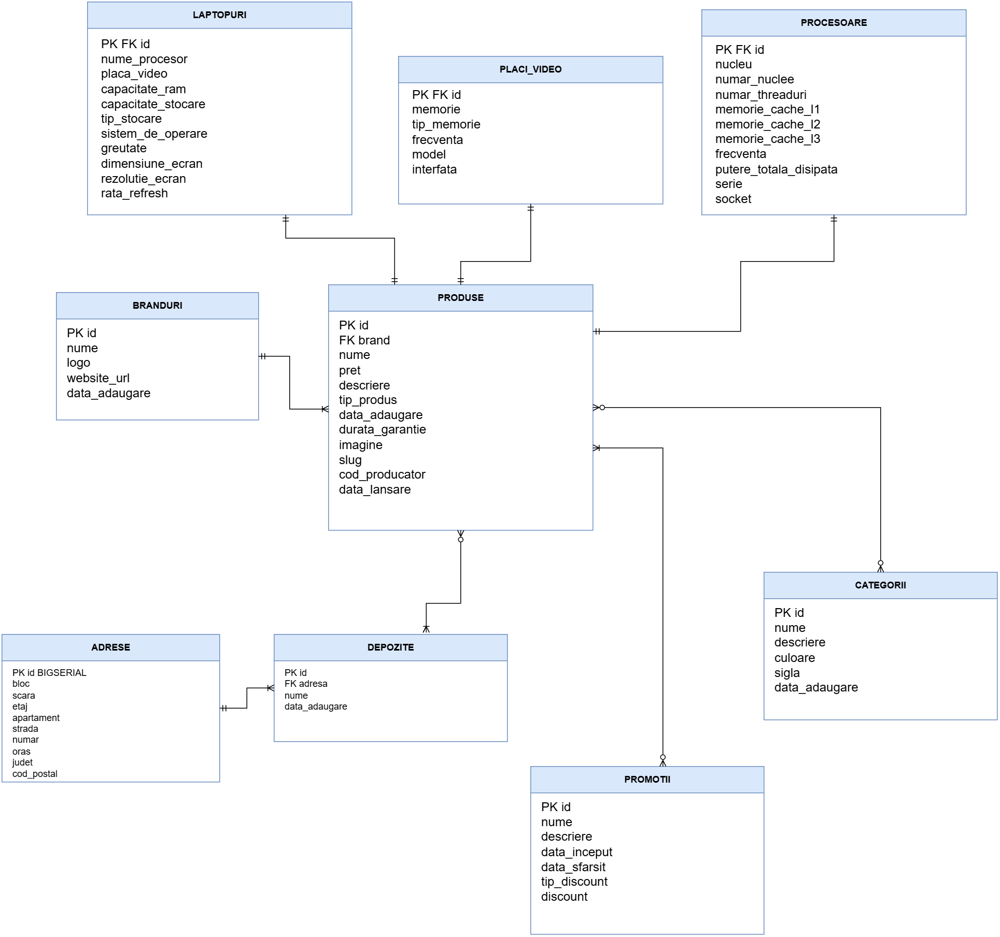

# Descriere

PC World este un magazin online specializat în comercializarea produselor IT, inspirat de platforme precum PC Garage, care își propune să ofere o experiență de cumpărare simplă și intuitivă. Magazinul comercializează produse hardware, precum laptopuri destinate activităților de lucru, studiu și gaming, precum și componente hardware de înaltă performanță.

## Continut

- Pagina principală – prezintă magazinul PC World și principalele sale oferte, fiind organizată în cinci secțiuni:
  - Secțiunea erou
  - Sectiunea cu laptopuri
  - Sectiunea cu placi video
  - Sectiunea cu procesoare
  - Sectiunea cu produse aflate la promotie

- Despre – Pagina este structurată în două secțiuni principale:
  - Sectiunea cu descrierea magazinului si a produselor comercializate
  - Sectiunea care prezintă misiunea și obiectivele acestuia.

- Istoric – permite utilizatorilor să consulte istoricul comenzilor efectuate

- Produse – permite utilizatorilor să consulte catalogul de produse disponibile în magazin, să vizualizeze detaliile acestora și să le filtreze în funcție de criterii precum categoria, producătorul sau prețul.

- Contact – oferă utilizatorilor informații despre modalitățile de contactare a magazinului, precum și un formular prin intermediul căruia aceștia pot trimite întrebări sau solicitări.

- Coș virtual – permite utilizatorilor să vizualizeze produsele adăugate în coș, să modifice cantitățile dorite și să consulte valoarea totală a comenzii înainte de finalizarea achiziției.

- Promoții – permite utilizatorilor să descopere produsele aflate la ofertă.

- Favorite – permite utilizatorilor să salveze produsele de care sunt interesați, pentru a le putea consulta ulterior și pentru a le găsi mai ușor atunci când doresc să le achiziționeze.

## Diagrama

